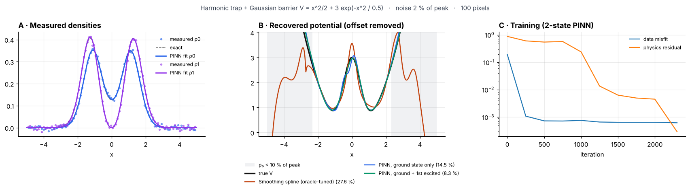
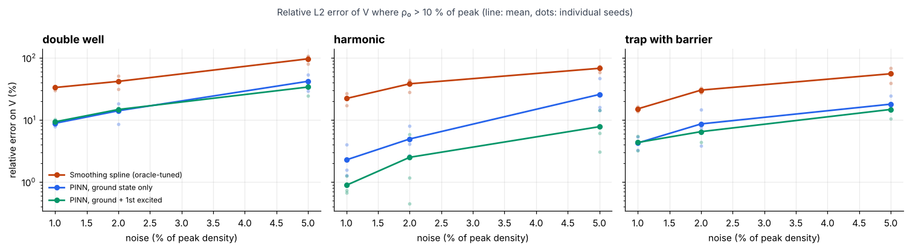

# Inverse Schrödinger PINN

**Recovering a quantum potential from noisy density measurements with physics-informed neural networks.**

Given a few dozen noisy pixels of the probability density |ψ(x)|² of a quantum system, which potential V(x) produced it? This repository solves that inverse problem with a physics-informed neural network (PINN). It compares the PINN against the classical inversion formula and ships a reproducible benchmark.



**Headline results** (3 potentials, 3 noise levels, 3 seeds; full tables below):

- **3–25× lower error than the classical inversion** in the well-observed region (2.3–10× with the ground state alone), even though the classical method has its smoothing parameter tuned against the ground truth, an advantage no real experiment has.
- **Using two eigenstates instead of one** reduces the error by up to 3.3× (harmonic trap at 5 % noise: 25.8 % → 7.8 %). The joint fit also returns the **energy gap E₁ − E₀ to within 0.2–4 %**, a spectroscopic quantity that was never measured.
- **Density-weighted residuals are what make the two-state model work**: without them, one benchmark case jumps from 6.6 % to 105 % error (ablation below).

---

## Why this problem matters

The density-to-potential map comes up wherever a quantum density can be imaged but the confining landscape cannot:

- **Cold-atom experiments.** Absorption or fluorescence imaging measures the atomic density directly. Calibrating the optical trap (laser speckle, barrier shape, residual gradients) is a density-to-potential inversion.
- **Density functional theory.** Finding the Kohn–Sham potential that reproduces a target density (the "inverse Kohn–Sham problem", Zhao–Morrison–Parr 1994; Wu–Yang 2003) is a long-standing and numerically delicate task. The single-particle problem solved here is its simplest instance.
- **Semiconductor nanostructures and scanning probes.** Local density of states maps from STM or quantum-dot charge sensing call for the same kind of inversion.

The problem is ill-posed in a very concrete way. For a nodeless ground state ψ₀ = √ρ₀, the Schrödinger equation inverts in closed form:

$$V(x) - E_0 = \frac{\psi_0''(x)}{2\,\psi_0(x)} = \frac{\rho_0''}{4\rho_0} - \frac{(\rho_0')^2}{8\rho_0^2}.$$

This needs the **second derivative of measured data** (noise amplification) and **divides by the density** (explosion in the tails). That is exactly the setting where building the physics into the model, rather than differentiating data, should pay off.

## Problem statement

Units ħ = m = 1, domain [−L, L], Dirichlet boundaries.

- **Measured:** noisy samples ρₙ(xᵢ) + εᵢ of one or two eigenstate densities (n = 0, 1) on 100 pixels, with Gaussian noise of standard deviation 1–5 % of the peak density.
- **Unknown:** V(x), the wavefunctions ψₙ, and the gap E₁ − E₀.
- **Gauge:** V is identifiable only up to an additive constant, so we fix E₀ = 0 and compare potentials after removing the best offset.
- **Identifiability:** V is only constrained where the density is above the noise. Errors are reported on the **core** region (ρ₀ > 10 % of peak) and on the harder **extended** region (ρ₀ > 1 %).

## Method

Three networks are trained jointly: V(x), plus one log-amplitude network per measured state.

**Ansatz.** ψ₀ = exp(h₀) is positive by construction. ψ₁ = (x − a)·exp(h₁) has exactly one node, at a learnable position a. Each hₙ(x) = MLPₙ(x/L) − Kₙ(x/L)² carries a learnable Gaussian envelope, so the decay is right from the first iteration.

**Log-form residuals.** Dividing the Schrödinger equation by exp(hₙ) gives residuals that stay O(1) where ψ is exponentially small:

$$r_0 = V - \tfrac12\left(h_0'' + h_0'^2\right), \qquad r_1 = -\tfrac12\left[u\left(h_1'' + h_1'^2\right) + 2h_1'\right] + (V - E_1)\,u,\quad u = x - a.$$

All derivatives are exact, by automatic differentiation.

**Why two states.** With the ground state alone, *any* positive ψ₀ is the exact ground state of V = ψ₀''/(2ψ₀). The residual can always be zeroed, and physics only acts as a structured regulariser. With two states sharing one potential, the system is over-determined: noise that is inconsistent between the two densities cannot be explained by any single V and gets rejected.

**Density weighting (the key ingredient).** Each residual rₙ is weighted by the current model density ρₙ (detached, plus a small floor). A state then shapes V only where that state is actually observed. Without this, the poorly determined tails and node region of ψ₁ corrupt V.

**Loss.**

$$\mathcal L = \sum_n \Big\langle \big(\hat\rho_n - \rho_n^{\text{obs}}\big)^2 \Big\rangle / \max\rho_n^{\text{obs}\,2} \;+\; w_{\text{res}} \sum_n \langle w_n\, r_n^2\rangle \;+\; w_{\text{smooth}}\,\langle V''^2\rangle,$$

where ρ̂ₙ = ψₙ² / ∫ψₙ² is normalised by quadrature.

**Optimisation.** 2,000 Adam steps (cosine learning-rate decay) followed by 300 L-BFGS steps, in float64. In two-state runs, the excited-state residual first updates only E₁ (a gap-tracking warm-up), then is ramped in. About 30 s (one state) or 45 s (two states) per run on one CPU core.

**Baseline.** A quintic smoothing spline of the measured ground-state density, inverted with the formula above, with the density floored at the noise level. Its smoothing factor is chosen from 11 values by **comparing against the true potential**: it is an *upper bound* on what spline inversion can achieve. A naïve finite-difference version is also included in `baselines.py`.

## Results

Relative L2 error of V (%), offset removed. Mean ± std over 3 seeds; 100 pixels.



| potential         | noise   | Spline (oracle) · core   | PINN 1-state · core   | PINN 2-state · core   | Spline (oracle) · ext   | PINN 1-state · ext   | PINN 2-state · ext   |
|:------------------|:--------|:-------------------------|:----------------------|:----------------------|:------------------------|:---------------------|:---------------------|
| double well       | 1 %     | 33.4 ± 2.8               | 8.9 ± 1.0             | 9.4 ± 0.8             | 132.2 ± 23.8            | 10.5 ± 0.9           | 14.7 ± 3.3           |
| double well       | 2 %     | 41.9 ± 10.0              | 14.1 ± 5.0            | 14.8 ± 0.9            | 85.7 ± 41.4             | 14.9 ± 2.5           | 20.7 ± 3.7           |
| double well       | 5 %     | 96.7 ± 13.8              | 42.1 ± 12.0           | 34.0 ± 8.4            | 115.2 ± 48.1            | 35.7 ± 8.4           | 33.1 ± 4.9           |
| harmonic          | 1 %     | 22.3 ± 4.9               | 2.3 ± 1.5             | 0.9 ± 0.3             | 176.9 ± 62.7            | 3.2 ± 3.7            | 0.6 ± 0.2            |
| harmonic          | 2 %     | 38.4 ± 8.7               | 5.0 ± 2.8             | 2.5 ± 3.0             | 107.4 ± 17.9            | 8.4 ± 6.4            | 1.8 ± 2.0            |
| harmonic          | 5 %     | 68.1 ± 8.3               | 25.8 ± 18.5           | 7.8 ± 5.8             | 75.6 ± 9.5              | 46.2 ± 23.2          | 5.5 ± 5.2            |
| trap with barrier | 1 %     | 15.1 ± 1.3               | 4.3 ± 1.1             | 4.4 ± 1.1             | 33.2 ± 11.6             | 5.0 ± 0.6            | 3.9 ± 1.4            |
| trap with barrier | 2 %     | 30.4 ± 2.7               | 8.7 ± 5.4             | 6.5 ± 2.2             | 48.8 ± 19.7             | 10.5 ± 3.8           | 6.2 ± 3.6            |
| trap with barrier | 5 %     | 55.7 ± 14.9              | 18.0 ± 5.7            | 14.8 ± 3.8            | 78.5 ± 39.8             | 29.9 ± 7.2           | 16.7 ± 2.9           |

**Energy gap recovered by the two-state PINN** (never measured directly):

| potential         | noise   |   true E1 − E0 | PINN estimate   | mean rel. error   |
|:------------------|:--------|---------------:|:----------------|:------------------|
| double well       | 1 %     |         0.366  | 0.3675 ± 0.0017 | 0.5 %             |
| double well       | 2 %     |         0.366  | 0.3669 ± 0.0027 | 0.5 %             |
| double well       | 5 %     |         0.366  | 0.3658 ± 0.0119 | 2.5 %             |
| harmonic          | 1 %     |         1      | 1.0017 ± 0.0018 | 0.2 %             |
| harmonic          | 2 %     |         1      | 1.0020 ± 0.0034 | 0.3 %             |
| harmonic          | 5 %     |         1      | 1.0014 ± 0.0154 | 1.1 %             |
| trap with barrier | 1 %     |         0.2179 | 0.2197 ± 0.0015 | 0.8 %             |
| trap with barrier | 2 %     |         0.2179 | 0.2209 ± 0.0028 | 1.3 %             |
| trap with barrier | 5 %     |         0.2179 | 0.2267 ± 0.0059 | 4.0 %             |

### Ablations

Core-region error (%) at 2 % noise, mean over 2 seeds (`experiments/ablation.py`):

| variant              | double well · 1-state   |   double well · 2-state | trap with barrier · 1-state   |   trap with barrier · 2-state |
|:---------------------|:------------------------|------------------------:|:------------------------------|------------------------------:|
| default              | 13.6                    |                    15   | 11.1                          |                           6.6 |
| w_res=1e-3           | 13.7                    |                    17.6 | 10.0                          |                           9.2 |
| w_res=3e-3           | 17.1                    |                    19   | 8.7                           |                           7.7 |
| w_res=3e-2           | 15.7                    |                    13.8 | 6.1                           |                           6.4 |
| no density weighting | 11.1                    |                    18.5 | 12.4                          |                         104.6 |
| no warm-up / ramp    | —                       |                    12.5 | —                             |                           5.8 |
| no gradient clipping | 13.6                    |                    15   | 11.1                          |                           6.6 |

### What the numbers say, honestly

- **The PINN always wins against the classical inversion**: by 2.8–25× in the core region for the best variant, and by 2.3–10× for the one-state model alone. The gap is even larger in the extended region, where the spline inversion breaks down (errors above 100 %) and the PINN degrades gracefully.
- **The second state helps most when the ground state alone is ambiguous**: smooth single-well traps at high noise (harmonic 5 %: 3.3× better). On the asymmetric double well, the two models are statistically tied in the core region, and the one-state model is better in the flanks at 1–2 % noise. The excited state's node sits right where the ground state is most informative, so it adds little information there.
- **Density weighting is essential for the two-state model** and harmless for the one-state model.
- **The residual weight is not a fragile knob**: a 30× range of w_res changes the errors by less than a factor of 2.
- **Two design choices turned out unnecessary in the final setup.** The warm-up/ramp curriculum was introduced to fix a collapse of the gap to ~0, which was ultimately caused by an unweighted residual and a badly initialised gap. Removing it is slightly better on this small ablation. Gradient clipping never activates (identical results). Both are kept in the default configuration because that is what the benchmark ran with. Removing them is the first simplification to test.
- **Hardest case:** the double well at 5 % noise. The barrier region has low density in the ground state, so the barrier height is the least constrained feature.

## Reproduce

```bash
pip install -r requirements.txt          # numpy, scipy, torch, matplotlib, pandas
pytest                                     # 10 tests, under a minute

# One reconstruction with the three-panel figure (about 1.5 min)
python experiments/run_single.py --potential trap_with_barrier --noise 0.02

# Full benchmark: 27 datasets × 3 methods (about 25 min on 2 cores)
python experiments/benchmark.py --workers 2

# Ablations (about 15 min on 2 cores)
python experiments/ablation.py --workers 2
```

Every number in this README comes from `results/benchmark.csv` and `results/ablation.csv`, produced by these scripts. `--summarise-only` rebuilds the tables and figures from the CSVs.

## Repository layout

```
src/invpinn/
  potentials.py   benchmark potentials (harmonic, asymmetric double well, trap + barrier)
  solver.py       finite-difference reference eigensolver
  data.py         synthetic noisy density measurements
  pinn.py         the inverse PINN: ansatz, residuals, density weighting, training
  baselines.py    classical inversion (naïve finite differences, smoothing spline, oracle spline)
  metrics.py      gauge-invariant errors on the identifiable region
  plotting.py     figures
experiments/      run_single.py, benchmark.py, ablation.py
tests/            solver accuracy, exact-solution residuals, gauge invariance, training smoke test
results/          CSVs, markdown tables, figures
```

## Limitations

- **Synthetic data only**, with an idealised noise model (additive Gaussian, uniform pixels, no imaging blur).
- **1D, single particle, at most two eigenstates.**
- **No uncertainty quantification yet.** The spread over seeds hints at it, but it is not a calibrated posterior.
- **The excited-state ansatz assumes exactly one node.** Higher states need a different parameterisation.

## Roadmap

1. **Uncertainty.** Deep ensembles or Laplace approximations, giving error bars that grow where V is not identifiable.
2. **Realistic imaging.** Point-spread function, shot noise, finite pixel size, and an unknown overall atom number.
3. **Nonlinear case.** Gross–Pitaevskii inversion for Bose–Einstein condensates, which adds a g|ψ|² term and makes the problem directly relevant to cold-atom trap calibration.
4. **2D potentials** (optical lattices with disorder, speckle) and comparison with operator-learning surrogates such as DeepONet trained on many potentials.
5. **Inverse Kohn–Sham.** Several orbitals sharing one potential, benchmarked against Wu–Yang and Zhao–Morrison–Parr inversions.
6. **Real data.** Public in-situ density images of trapped atoms.

## References

- M. Raissi, P. Perdikaris, G. E. Karniadakis, "Physics-informed neural networks", *J. Comput. Phys.* 378, 686 (2019).
- S. Wang, Y. Teng, P. Perdikaris, "Understanding and mitigating gradient flow pathologies in physics-informed neural networks", *SIAM J. Sci. Comput.* 43 (2021).
- Q. Zhao, R. C. Morrison, R. G. Parr, "From electron densities to Kohn–Sham kinetic energies, orbital energies, exchange-correlation potentials", *Phys. Rev. A* 50, 2138 (1994).
- Q. Wu, W. Yang, "A direct optimization method for calculating density functionals and exchange–correlation potentials from electron densities", *J. Chem. Phys.* 118, 2498 (2003).
- D. S. Jensen, A. Wasserman, "Numerical methods for the inverse problem of density functional theory", *Int. J. Quantum Chem.* 118, e25425 (2018).

## License

MIT
